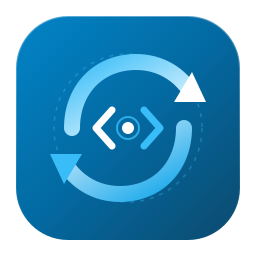

# CodeSync Studio

> 面向开发者的 Git / SVN 仓库拉取、增量同步、代码推送与版本发布一体化桌面工具。



## 📖 项目简介

**CodeSync Studio** 是一款基于 **Electron + React + Vite** 构建的 Windows 桌面应用，以赛博深色玻璃拟态工作台将日常分散在命令行的 Git / SVN 仓库管理操作一站式可视化集成（支持全工作台自适应窄屏与快捷键操作）：

- **单仓同步**：拉代码、切分支 / Tag / SVN 修订号，目录树按需稀疏检出，快速载入最近记录
- **批量拉取**：一次粘贴多个 Git / SVN 地址队列拉取，独立选择分支与子目录，失败项一键重试
- **代码推送**：扫描工作区改动、语义高亮文件 Diff 预览、勾选提交并安全推送
- **版本发布**：直连 GitHub / Gitee 发布 Release、自动扫描构建产物、流式上传多附件并自动生成中文更新说明
- **本地仓库管家**：一键盘点全工作区 Git / SVN 仓库、对比本地与远程差异（含哈希对照）、批量更新或直达终端 / VS Code
- **网络与凭据安全**：公私网代理智能分流（内网直连 / 公网代理）、Git 全局身份一键写入、Windows DPAPI 加密凭据存储与 GCM 智能回退

所有命令都在**本机执行**，仓库地址、代码与凭据不会上传到任何第三方服务。凭据使用 Windows DPAPI（Electron SafeStorage）加密保存，仅在命令执行期间注入，不会出现在日志中。

---

## 🧭 功能模块

| 菜单 | 说明 |
| --- | --- |
| **单仓同步** | 单仓库的克隆 / 更新，分支、Tag、修订号切换，目录树按需检出 |
| **批量拉取** | 多链接队列拉取，每行一个地址，Git / SVN 分开管理 |
| **代码推送** | 工作区变更扫描、文件级 Diff、提交并推送（Git / SVN） |
| **版本发布** | GitHub / Gitee Release 发布 + 附件上传进度 |
| **本地仓库** | 一键扫描本地工作区下所有仓库，批量更新、远程同步状态对比 |
| **同步记录** | 历史任务检索、配置重载、直达本地目录 |

---

## ✨ 核心特性

### 🔀 双引擎 · Git 与 SVN

- 原生支持 Git 与 SVN 两种版本控制系统，命令直调本机 CLI
- 输入或粘贴地址时自动识别协议（`svn://`、`/trunk`、`/branches`、`/tags` → SVN；`git@`、`.git` → Git），避免用错引擎导致证书与协议报错

### 📥 单仓同步

- 克隆拉取 / 增量更新两种模式，支持指定分支、Tag、SVN 修订号
- **目录树按需检出**：拉取前浏览远程目录结构，只检出需要的子目录（Git `sparse-checkout` / SVN 深度检出），大仓库也能秒拉
- **SVN 仅拉主线 trunk**：输入项目根地址时自动定位 `trunk`，不下载 `branches` / `tags`
- Git 浅克隆（`--depth=1`）、递归子模块（`--recurse-submodules`）
- 剪贴板一键粘贴地址、最近同步记录快捷载入

### 📚 批量拉取

- 一行一个链接粘贴，或从 `.txt` / `.list` 文件导入，自动去重、跳过空行
- **Git 与 SVN 独立列表**，互不干扰，误贴协议会给出提示
- 每个仓库可**独立下拉选择分支 / Tag / 修订号**，一键批量探测所有仓库的可用版本
- 每个仓库可**独立指定按需拉取的子目录**，也可一键应用到全部
- 目标目录已存在时策略：自动增量更新 / 跳过 / 标记错误继续
- 队列可视化：逐项状态、失败项一键重试、运行中随时停止

### 📤 代码推送

- 自动扫描 Git / SVN 工作区变更，按状态着色（修改 / 新增 / 删除 / 重命名 / 冲突）
- 文件级 **Diff 差异预览**，语法高亮展示增删行、Hunk 区块与元信息，「仅错误」筛选不再误筛删除行
- 按需勾选待提交文件，填写 Commit 说明（内置 `feat` / `fix` / `chore` / `docs` / `refactor` 模板）
- 推送策略：自动提交、先拉再推（`pull --rebase`）、安全强推（`--force-with-lease`）、附带标签推送（`--tags`）
- 自动识别并展示远程仓库（`owner/repo` + 平台徽标）、当前分支与待推提交数

### 🚀 版本发布

- 可视化 GitHub / Gitee Release 发布，自动识别本地 `package.json` 版本号
- 自动扫描 `release-*` / `dist` 目录下的打包产物，支持手动添加附件、行内重命名
- 访问令牌支持明文/密文显隐切换，方便核对粘入的 Token
- 附件逐个流式上传，实时显示速度与百分比进度
- 一键从 Git 提交记录生成**中文 Release Notes**（自动翻译 `feat` / `fix` / `chore` 摘要）
- 支持推送标签、预发布（Pre-release）、草稿（Draft）

### 🗂️ 本地仓库管家

- 扫描工作区根目录，递归识别所有 Git / SVN 仓库
- **远程一致性对比**：实时显示 `✓ 与远程一致` / `↓ 需更新 · 落后 N`（含 `本地哈希 → 远程哈希`）/ `↑ 待推送` / `⇅ 需同步`
- 一键更新全部落后仓库，或逐个操作
- 每行快捷操作（7 项）：更新、推送、发布、载入单仓、打开文件夹、**在此目录打开终端**、**用 VS Code 打开**
- 自适应表格列宽与横向滚动兜底，`1080×720` 最小窗口下 9 列信息与操作按钮依然完整可见

### 🌐 网络与身份

- **代理设置**：跟随系统 / 不使用代理 / 自定义 HTTP·SOCKS 代理（支持账号密码）
- **智能分流**：仅公网仓库走代理，局域网与内网地址自动直连，解决「内网 + 代理并存」下的 TLS 握手失败与连接重置
- **Git 全局身份一键写入**：直接读写 `git config --global user.name / user.email`，新仓库首次提交不再报错
- 支持**未保存更改提醒**、`Enter` 快捷保存，以及密码 / Token / 口令显隐切换
- 运行环境信息面板：版本 / Electron / Chromium / Node / 架构

### 🔐 安全与稳定性

- 凭据（HTTPS Token / SSH 私钥口令 / SVN 密码）使用 Windows DPAPI 加密存储
- Git 凭据智能回退：内置 Token 失效返回 `403` / `401` 时，自动回退 Windows Git Credential Manager
- SVN 工作副本锁自愈：遇到 `E155037` / `E155004` 自动执行 `svn cleanup` 后重试
- 全链路 UTF-8：中文路径、中文 Commit Message、中文 Release 正文均不乱码
- 内网自签名证书兼容：内网地址自动跳过 SSL 严格校验

### ⌨️ 键盘快捷键

| 快捷键 | 功能 |
| --- | --- |
| `Ctrl + 1` ~ `Ctrl + 6` | 切换 单仓同步 / 批量拉取 / 代码推送 / 版本发布 / 本地仓库 / 同步记录 |
| `Ctrl + Enter` | 执行当前工作台的主操作（拉取 / 批量拉取 / 推送 / 发布） |
| `Ctrl + K` | 聚焦当前页面搜索过滤框（批量拉取 / 本地仓库 / 同步记录） |
| `Esc` | 关闭「连接与网络设置」弹窗 |

---

## 🛠️ 技术栈

| 层 | 技术 |
| --- | --- |
| 前端框架 | [React 18](https://react.dev/) + [Vite](https://vitejs.dev/) |
| 桌面运行时 | [Electron](https://www.electronjs.org/) |
| 图标库 | [lucide-react](https://lucide.dev/) |
| 打包工具 | [electron-builder](https://www.electron.build/) |

---

## 🚀 快速上手

### 环境要求

- Node.js >= 18.0.0
- Git 客户端（需支持 `sparse-checkout`，建议 2.25+）
- SVN 客户端（Subversion 1.8+）

### 1. 安装依赖

```bash
npm install
```

### 2. 开发模式

启动 Vite 热重载开发服务器：

```bash
npm run dev
```

另开一个终端启动 Electron 桌面窗口：

```bash
npm run desktop
```

### 3. 构建与打包

```bash
npm run build      # 仅构建前端资源到 dist/
npm run package    # 构建 + 打包为 Windows 安装版与便携版
```

打包流程做了以下优化：

- 应用资源打包为单个 `app.asar`（文件数 100+ → 1，冷启动更快）
- 精简 Electron 语言包（仅保留 `zh-CN` / `en-US` / `en-GB`，省约 39 MB）
- 最高压缩等级

打包产物位于：

- `release-installer-codesync/`：安装包、便携单文件版、便携压缩包
- `release-portable/`：免安装目录版

---

## 📦 发行版下载

最新版本请前往 [**Releases**](../../releases) 页面下载。

产物命名固定为三种：

| 文件 | 说明 |
| --- | --- |
| `CodeSync.Studio.Setup.<version>.exe` | NSIS 安装程序（支持自定义安装目录、创建桌面快捷方式） |
| `CodeSync.Studio.<version>.exe` | 便携单文件版，双击即用 |
| `CodeSync-Studio-<version>-portable.zip` | 便携压缩包，解压后运行目录内 `CodeSync Studio.exe` |

---

## 📝 版本历史

### v1.4.6

**响应式布局与窄屏体验重构**

- 顶栏导航改用三列自适应网格并动态收敛窄屏按钮间距，彻底消除 `1080×720` 窗口下标题与「凭据配置」按钮重叠遮挡
- 调整双栏断点逻辑：`1020px~1260px` 维持紧凑并排双栏工作台，告别 `1080×720` 最小窗口下左右卡片上下堆叠被压扁的问题
- 优化「本地仓库」9 列宽比例与横向滚动兜底，确保 `1080×720` 下全部列信息及 7 项快捷操作完整可见且表头清晰无粘连
- 修复「同步记录」表头（如「远程仓库地址」）在窄屏折成两行的问题
- 优化设置弹窗在 720p 高度下的内区滚动布局与侧边栏悬停 1px 防抖动

**交互与视觉细节打磨**

- 修复 `Esc` 关闭设置弹窗快捷键失效问题，防止弹窗开启时 `Ctrl+Enter` 误触后台任务，增强 `Ctrl+K` 跨工作台聚焦搜索框
- 代码推送 Diff 预览支持新增 / 删除 / Hunk / 元信息语义高亮，删除行不再被「仅错误」过滤误判
- 连接设置与版本发布令牌输入框支持密码/Token 明密文显隐切换；「网络与身份」新增未保存变更提示、`Enter` 快捷保存与空值校验
- 全工作台终端统一「复制」成功即时反馈与本地化时间戳，修复连续弹出 Toast 时定时器提前清空提示的问题
- 全局统一暗色原生下拉框与 `:focus-visible` 青色焦点环，清理冗余图标导入

### v1.4.5

**启动性能与体积优化**

- 资源改为单文件 `app.asar` 打包，冷启动磁盘寻道与杀软扫描大幅减少
- 移除窗口「等待首帧就绪」阻塞，主窗口立即可见
- Git / SVN 版本探测延迟异步化，不再阻塞首屏
- 启用 V8 代码缓存，二次启动复用已编译代码
- 关闭 Chromium 拼写检查、精简 52 个语言包、最高压缩等级
- 热启动实测约 **900 ms → 450~520 ms**；安装包 **76.66 MB → 69.52 MB**；便携包 **109.95 MB → 99.96 MB**

**新增功能**

- 网络代理设置（跟随系统 / 直连 / 自定义 HTTP·SOCKS），内网自动直连
- Git 全局身份一键写入 `user.name` / `user.email`
- 本地仓库行内「打开终端」「用 VS Code 打开」
- 全局键盘快捷键（`Ctrl+1~6` 切菜单、`Ctrl+Enter` 执行、`Ctrl+K` 搜索）
- 运行环境信息面板

**界面修复**

- 分支选择器统一为原生下拉控件（推送分支 / 目标分支）
- 修复「推送范围」被长仓库名撑破卡片
- 修复「目标分支」下拉箭头被裁切
- 修复「本地仓库」表格列重叠、操作按钮压盖路径
- 修复「批量拉取」队列列溢出、子目录按钮占位过宽
- 修复「待推提交」标签换行、「推送策略」按钮被截断
- 提交说明 / 更新说明编辑框弹性填充，消除卡片底部大块空白

### v1.4.4

- 全场景同步记录自动归档：本地仓库单行/一键更新、批量队列单行执行均写入「同步记录」
- 历史记录按「仓库目录 + 操作类型」去重，保留上限 10 → 50 条

### v1.4.3

- 「本地仓库」新增远程同步状态实时对比（`✓ 与远程一致` / `↓ 需更新 · 落后 N` / `↑ 待推送` / `⇅ 需同步`）
- 新增「需更新 (N)」快捷筛选
- 修复 Detached HEAD 状态下增量更新报错，自动切回默认主分支
- 远程状态检测接入 GCM 凭据自动回退

### v1.4.2

- 修复 Release 附件上传完成后进度停留在 96% 的竞态问题
- 修复批量队列单行执行日志串流到单仓面板
- 修复长日志缓冲区满后停止自动滚屏
- 版本发布面板双列对称布局重构，发布选项收纳为胶囊开关
- 凭据弹窗精简，测试连接自动匹配当前页面仓库地址

### v1.4.1

- 新增版本发布（Release）工作台，支持 GitHub / Gitee 与附件流式上传
- 新增中文 Release Notes 自动生成
- 新增待推提交文件清单与 Diff 预览
- 全链路 UTF-8 中文防乱码
- Git 凭据智能回退（修复 403 / 401）
- 顶部导航栏防偏移锁定

### v1.4.0

- 新增「代码推送」工作台（变更扫描、Diff 预览、提交与推送）
- 新增「本地仓库」管家菜单（扫描、批量更新、跳转）
- 批量拉取支持子目录按需检出（Sparse Checkout）
- 单仓同步支持浅克隆、子模块递归、剪贴板粘贴
- 一体化深色顶栏与单屏紧凑布局

<details>
<summary>更早版本（v1.0.x ~ v1.3.x）</summary>

- **v1.3.1**：全屏无滚动布局、独立「同步记录」页、ClearType 字体渲染优化
- **v1.3.0**：批量拉取队列与实时终端、分屏对照视图
- **v1.2.1**：修复 SVN 仅拉主线、终端 GBK 乱码、右侧面板高度失控
- **v1.2.0**：参考微信/钉钉/QQ NT 的极简导航轨与大厂级浅蓝卡片布局
- **v1.1.0**：全新浅蓝卡片视觉体系与流线型同步 Logo
- **v1.0.x**：批量拉取、每仓库独立选版本、内网代理绕过与 Windows 凭据修复

</details>

---

## ❓ 常见问题

<details>
<summary><b>批量拉取时提示「Remote branch HEAD not found」</b></summary>

旧版本会向 `git clone` 传入 `--branch HEAD`，Git 无法识别该符号引用。v1.0.12 起已修复，留空分支即自动使用远端默认分支。
</details>

<details>
<summary><b>内网 GitLab 探测分支时报红叹号 / TLS 错误</b></summary>

多为本地代理拦截了内网请求，或 Windows 下凭据注入语法不兼容。v1.0.16 起内网地址自动绕过代理，并改用原生 `GIT_ASKPASS`；v1.4.5 起可在「连接设置 → 网络与身份」手动指定代理。
</details>

<details>
<summary><b>SVN 报 <code>E155037: Previous operation has not finished</code></b></summary>

上一次拉取被中断，工作副本残留锁定记录。v1.4.5 起会自动执行 `svn cleanup` 并重试；也可手动在目标目录执行 `svn cleanup`。
</details>

<details>
<summary><b>提交时提示 <code>Please tell me who you are</code></b></summary>

本机未配置 Git 全局身份。打开「连接设置 → 网络与身份」，填写姓名与邮箱后点击「写入 Git 全局配置」。
</details>

<details>
<summary><b>能否在 macOS / Linux 上运行</b></summary>

核心逻辑基于 Node.js 与 Git / SVN CLI，跨平台可行；当前打包配置面向 Windows，其他平台需自行调整 `electron-builder` 目标。
</details>

---

## 📄 开源许可

本项目遵循 **MIT License**。
